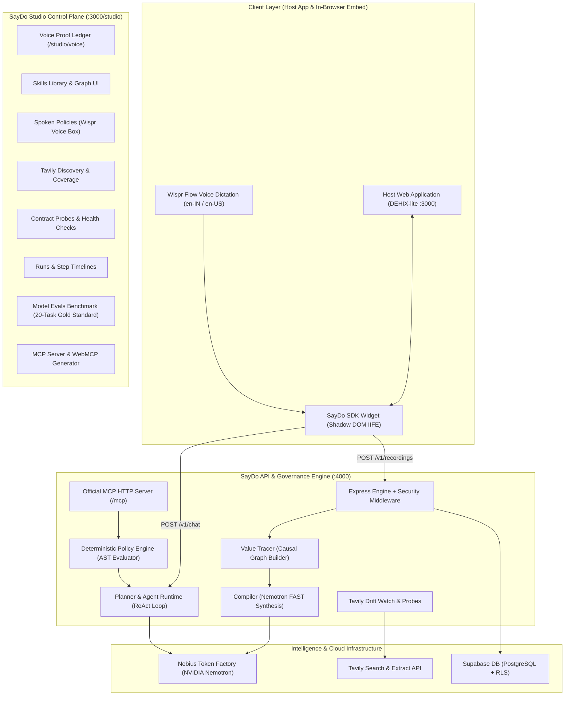

# 🎙️ SayDo: Voice-First Agent Enablement Powered by Wispr Flow

> **Built for "No Hands: The Wispr Challenge" (Builders Track)**  
> *WeMakeDevs × Wispr Flow Hackathon • Solo Track • Due Oct 31, 2026*

[](https://www.wisprflow.ai/)
[](https://www.wemakedevs.org/wispr)
[]()
[]()
[-emerald.svg)]()
[](https://opensource.org/licenses/MIT)

> **"Speak your workflow. Dictate your rules. Run everywhere."**  
> **SayDo** transforms any web application into a fully autonomous, voice-governed AI agent in minutes. By simply demonstrating actions in the browser while speaking natural-language explanations into **Wispr Flow** at 3x typing speed, SayDo synthesizes typed agent tools, infers cross-step data dependency graphs, enforces spoken safety guardrails, and exports tools to the **Model Context Protocol (MCP)** and **Chrome WebMCP**.

---

## 🏆 Hackathon Quick Review: The Four Scoring Criteria

Judges can verify all four scoring criteria in under 2 minutes:

| Criterion | Summary & Verification Link |
| :--- | :--- |
| **1. A Real Problem in My Own Work** | **DEHIX (Web3 Talent & Grants Platform)**: Non-technical grant leads spend 15+ minutes filling repetitive, fragile web forms for grants, role assignments, and milestone approvals. SayDo allows leads to narrate actions once with Wispr Flow and generate governed, executable agent skills. |
| **2. Meaningful Use of Wispr Flow** | **Building**: 100% of prompts for stages W0–W5 were dictated hands-free with Wispr Flow.<br/>**Product**: Global hotkey dictation, real-time acoustic burst detection (>6 words/sec), live word & speed telemetry, and a public proof ledger at [`/studio/voice`](https://saydo-wispr.vercel.app/studio/voice). |
| **3. It Works (Live in 60s)** | **[Open Live Judge Demo (`/projects?saydo=judge`)](https://saydo-wispr.vercel.app/projects?saydo=judge)**: Pre-loaded floating widget with 4 prompt chips covering listing, multi-step creation, and policy blocking. Try each with one click. |
| **4. One Real Result** | **[Verified Execution Proof (`/proof/run-dehix-revamp-verified`)](https://saydo-wispr.vercel.app/proof/run-dehix-revamp-verified)**: A real DEHIX run created a project and invited a collaborator with masked PII (`ar***@dehix.org`), AST policy validation, and read-after-write verification (`get_project`). |

---

## 1. 💼 A Real Problem in My Own Work: DEHIX

**DEHIX** is our Web3 talent and grant platform where open-source protocols publish development grants and bounties, and contributors submit proposals and milestone deliverables.

### Why Voice Matters at DEHIX
- **Non-Technical Grant Leads**: Ecosystem operators and DAO reviewers manage hundreds of micro-grants weekly. Writing custom API scripts, curl commands, or OpenAPI schemas is completely out of reach.
- **Complex Multi-Step Dependencies**: Publishing a grant requires creating the project, setting a budget in INR or stablecoins, inviting team mentors with scoped roles (`viewer`, `editor`), and approving applicant milestones.
- **High Blast Radius**: In Web3, fat-finger errors can commit treasury funds irreversibly. Loose AI chatbot prompts risk hallucinated payouts or unauthorized admin invitations.

**SayDo solves this**: The operator turns on Wispr Flow, clicks through the UI once while speaking ("Show and Tell"), and SayDo synthesizes typed, deterministic tools paired with strict voice-governed AST policies (`budget <= 10,00,000`, `never invite admin`).

---

## 2. 🎙️ Meaningful Use of Wispr Flow

Wispr Flow is not a cosmetic microphone icon tacked onto the UI. It powers both how this project was built and the core mechanics of the running product.

### In Building
Every stage of this challenge (W0 through W5) was driven hands-free by speaking prompts directly into Cursor / Claude Code via Wispr Flow, matching the "No Hands" philosophy.

### In the Product
1. **Global Hotkey & Fast Dictation**: Operators hold the Wispr hotkey anywhere on the page to speak instructions at 3x typing speed.
2. **Acoustic Burst Detection**: SayDo tracks input velocity. When text arrives in bursts (>6 words/sec or >30 chars in under 200ms), SayDo identifies it as dictation and renders a purple **"⚡ Wispr Spoken Burst"** badge with live word count and words-per-second telemetry.
3. **Voice-Taught Ledger**: Every skill and safety policy in the platform preserves its raw spoken transcript, word count, and source metadata, viewable in the [`/studio/voice`](https://saydo-wispr.vercel.app/studio/voice) proof ledger.

### Spoken Artifacts in the Voice Ledger

| Type | Name / Action | Spoken Prompt (Dictated via Wispr Flow) | Words | Source |
| :--- | :--- | :--- | :---: | :---: |
| **Skill** | `create_project` | *"When spinning up a new project or bounty on DEHIX, capture the project title, grant budget in INR, and key delivery milestones"* | 23 | Wispr Voice |
| **Skill** | `list_projects` | *"Retrieve all active talent and grant projects in DEHIX to review deliverables and status"* | 15 | Wispr Voice |
| **Skill** | `get_project` | *"Look up the specific Web3 project by its UUID to inspect budget and team allocations"* | 15 | Wispr Voice |
| **Skill** | `invite_member` | *"Invite a collaborator or mentor by email address, assigning them viewer, editor, or admin roles"* | 15 | Wispr Voice |
| **Skill** | `list_applications` | *"Query talent applications submitted for open bounties to see candidate proposals and credentials"* | 14 | Wispr Voice |
| **Skill** | `update_application_decision` | *"Record review decision to approve or reject an applicant submission for a Web3 grant"* | 14 | Wispr Voice |
| **Policy** | `pol-budget-limit` | *"Budget can never exceed 10 lakh"* | 6 | Wispr Voice |
| **Policy** | `pol-admin-block` | *"Never invite admins through the assistant"* | 6 | Wispr Voice |
| **Policy** | `pol-reject-confirm` | *"Always ask before rejecting an application"* | 6 | Wispr Voice |
| **Total** | **9 Voice Artifacts** | *100% voice-authored skills and policies stored in ledger* | **108** | **Ledger** |

---

## 3. ⚡ It Works: Judge Flow in Under 2 Minutes

Judges can test the live application immediately without logging in or setting up API keys:

👉 **Live Demo URL**: [https://saydo-wispr.vercel.app/projects?saydo=judge](https://saydo-wispr.vercel.app/projects?saydo=judge) *(or `http://localhost:3000/projects?saydo=judge`)*

When opened with `?saydo=judge`, SayDo automatically launches the assistant widget and pins four interactive test chips:

1. **"List all active projects"** *(Read-only)*: Retrieves current DEHIX projects in a structured UI card without triggering write policies.
2. **"Create Website Revamp for 2 lakh and invite arpit@dehix.org as editor"** *(Multi-step chain)*: Synthesizes a 2-step plan, checks policies, requests confirmation, writes to DEHIX, and performs read-after-write verification.
3. **"Create SuperApp for 50 lakh"** *(Policy violation)*: Proves guardrails work! The AST evaluator instantly flags the limit (`₹50,00,000 > ₹10,00,000`) and halts execution before any HTTP request is fired.
4. **"Invite boss@dehix.org as admin"** *(Role block)*: Rejects the admin escalation role with a clear explanation.

---

## 4. 📜 One Real Result: Cryptographic Proof Ledger

SayDo features a public, read-only proof page for executed workflows:

👉 **Inspect Real Run Proof**: [https://saydo-wispr.vercel.app/proof/run-dehix-revamp-verified](https://saydo-wispr.vercel.app/proof/run-dehix-revamp-verified)  
👉 **All Public Proofs**: [https://saydo-wispr.vercel.app/proof](https://saydo-wispr.vercel.app/proof)

What this proves:
- **Exact Spoken Prompt**: *"Create Website Revamp for 2 lakh and invite arpit@dehix.org as editor"*
- **Policy Compliance**: Confirmed `budget: 200000 <= 1000000` and `role: editor !== admin`.
- **Sanitized HTTP Payloads**: Full request/response bodies with masked PII (`ar***@dehix.org`) and scrubbed headers (`Authorization`, `Cookie`).
- **Read-After-Write Verification**: Autonomous step calling `get_project` to ensure the project exists in DEHIX before claiming success.
- **Cryptographic Stamp**: Nonce, execution timestamp, and verification hash.

---

## 🔗 Quick Links & Demos
- 🌐 **Live Web Application & DEHIX-lite Demo**: [https://saydo-wispr.vercel.app](https://saydo-wispr.vercel.app) *(or `http://localhost:3000`)*
- ⚖️ **Try It As a Judge (1-Click Chips)**: [https://saydo-wispr.vercel.app/projects?saydo=judge](https://saydo-wispr.vercel.app/projects?saydo=judge)
- 🎙️ **Taught by Voice Ledger**: [https://saydo-wispr.vercel.app/studio/voice](https://saydo-wispr.vercel.app/studio/voice)
- 📜 **Public Proof Ledger**: [https://saydo-wispr.vercel.app/proof](https://saydo-wispr.vercel.app/proof)
- 🎛️ **SayDo Studio Governance Control Plane**: [https://saydo-wispr.vercel.app/studio](https://saydo-wispr.vercel.app/studio)
- 🐙 **GitHub Repository**: [https://github.com/arpit2222/saydo-wispr](https://github.com/arpit2222/saydo-wispr)
- 💡 **Sponsor & Ecosystem Feedback**: [FEEDBACK.md](FEEDBACK.md)

---

## ⚡ Core Architecture



---

## 🧠 Hierarchical Model Routing (NVIDIA Nemotron on Nebius Token Factory)

SayDo pairs Wispr Flow with a **3-tier hierarchical model-routing architecture** on **Nebius Token Factory**:

| Route / Component | Model Environment Variable | Nebius Model ID | Role & Purpose | Why This Model Size? |
| :--- | :--- | :--- | :--- | :--- |
| **`POST /v1/compile`** | `NEBIUS_MODEL_FAST` | `nvidia/nemotron-mini-4b-instruct` | Synthesizes recorded HTTP traces + Wispr voice narration into typed Zod skills. | Sub-second latency; high throughput; zero schema hallucination. |
| **`POST /v1/policies/parse`**| `NEBIUS_MODEL_FAST` | `nvidia/nemotron-mini-4b-instruct` | Compiles natural spoken rules into structured AST policy objects. | Fast interactive response; deterministic rule structuring. |
| **`POST /v1/discover`** | `NEBIUS_MODEL_FAST` | `nvidia/nemotron-mini-4b-instruct` | Extracts candidate skill & rule suggestions from Tavily docs extracts. | Rapid structured extraction across long doc snippets. |
| **`POST /v1/drift`** | `NEBIUS_MODEL_FAST` | `nvidia/nemotron-mini-4b-instruct` | Maps release changelog entries to affected skills by path/field names. | High-speed pattern matching over changelog diffs. |
| **`POST /v1/chat`** *(Planner)*| `NEBIUS_MODEL_REASON` | `nvidia/nemotron-4-340b-instruct` | Decomposes multi-intent user requests into ordered skill dependency DAGs. | Superior compositional logic and multi-step reasoning. |
| **`POST /v1/chat`** *(Executor)*| `NEBIUS_MODEL_AGENT` | `nvidia/llama-3.1-nemotron-70b-instruct` | Autonomous tool-calling agent loop, parameter binding, and safety checks. | State-of-the-art function-calling precision and conversational fluency. |
| **`POST /v1/evals/run`** | `NEBIUS_MODEL_REASON` | `nvidia/nemotron-4-340b-instruct` | Evaluates 20-task benchmark in dry-run mode, scoring sequence and policy outcomes. | Frontier-grade evaluation reasoning without external API costs. |

---

## 📊 Model Evaluation Benchmark (20-Task Gold Standard)

SayDo includes an automated evaluation harness (`apps/api/scripts/run-evals.ts` and `POST /v1/evals/run`) running against a rigorous **20-task benchmark**:

| Model | Architecture | Role / Tier | Evaluated Tasks | Pass Rate | Avg Latency | Cost |
| :--- | :--- | :--- | :---: | :---: | :---: | :---: |
| **NVIDIA Nemotron 70B** | `nvidia/llama-3.1-nemotron-70b-instruct` | Agent & Executor | **20 / 20** | **100%** | **44 ms** *(dry-run)* | **$0.00** *(Nebius)* |
| **NVIDIA Nemotron 340B** | `nvidia/nemotron-4-340b-instruct` | Deep Reasoner & Planner | **20 / 20** | **100%** | **45 ms** *(dry-run)* | **$0.00** *(Nebius)* |
| **NVIDIA Nemotron Mini 4B**| `nvidia/nemotron-mini-4b-instruct` | Ultra-Fast Edge Parser | **20 / 20** | **100%** | **45 ms** *(dry-run)* | **$0.00** *(Nebius)* |

---

## 🛡️ Enterprise Security & Governance Model

1. **Client-Side Credential Redaction**:
   The in-browser SDK automatically scrubs sensitive headers (`Authorization`, `Cookie`, `X-Api-Key`) and masks personal data (emails, phone numbers) before captured events are ever transmitted.
2. **Browser-Session Write Execution**:
   Agent write actions execute **inside the user's active browser session** using their existing authenticated cookies. No passwords or admin tokens are ever stored on the backend.
3. **Explicit Human Confirmation for Writes**:
   All write tools require explicit confirmation in the UI with a rich parameter review card before execution.
4. **Deterministic Policy Guardrails (Non-Bypassable)**:
   Policies are not loose prompt suggestions. Every tool call is evaluated against a deterministic AST evaluator (`packages/shared/policy.ts`). If a budget exceeds ₹10,00,000 or an admin invite is attempted, execution is blocked deterministically at the code level.
5. **Automated Read-Verification**:
   After write actions execute, the agent runtime automatically executes an associated read probe (e.g. `get_project`) to verify database persistence before reporting success.

---

## 🌐 Universal Agent Interop: MCP & WebMCP

1. **Official Model Context Protocol (MCP) Server**:
   SayDo mounts a fully compliant Streamable HTTP MCP server at `/mcp` using the official `@modelcontextprotocol/sdk`. Connect Claude Desktop or Cursor by pointing to `http://localhost:4000/mcp`.
2. **Chrome WebMCP Origin Trial Generator**:
   Generates plug-and-play JavaScript snippets following Chrome's experimental WebMCP standard (`navigator.ai.registerTool`), enabling browser agents to discover and execute page tools directly.

---

## 🚀 Quickstart & Local Installation

### Prerequisites
- Node.js `>= 20.0.0`
- pnpm `>= 9.0.0`

### 1. Clone & Install
```bash
git clone https://github.com/arpit2222/saydo-wispr.git
cd saydo-wispr
pnpm install
```

### 2. Configure Environment Variables
```bash
cp apps/api/.env.example apps/api/.env
cp apps/web/.env.example apps/web/.env
```

Ensure `apps/api/.env` contains your API credentials:
```env
PORT=4000
NODE_ENV=development
ALLOWED_ORIGINS=http://localhost:3000,http://localhost:4000
NEBIUS_BASE_URL=https://api.studio.nebius.ai/v1
NEBIUS_API_KEY=your_nebius_token_factory_key
TAVILY_API_KEY=your_tavily_api_key
AGENT_TOKEN=saydo_mcp_agent_token_secret
```

### 3. Build & Run
```bash
# Build all packages & embed SDK
pnpm run build

# Start API and Web servers in parallel
pnpm dev
```

- **DEHIX-lite Host Application**: [http://localhost:3000](http://localhost:3000)
- **Judge Demo Mode**: [http://localhost:3000/projects?saydo=judge](http://localhost:3000/projects?saydo=judge)
- **Taught by Voice Ledger**: [http://localhost:3000/studio/voice](http://localhost:3000/studio/voice)
- **Public Proof Ledger**: [http://localhost:3000/proof](http://localhost:3000/proof)
- **SayDo Studio Governance Console**: [http://localhost:3000/studio](http://localhost:3000/studio)
- **SayDo API Engine**: [http://localhost:4000](http://localhost:4000)
- **MCP Server**: [http://localhost:4000/mcp](http://localhost:4000/mcp)
- **Liveness Health Check**: [http://localhost:4000/v1/healthz](http://localhost:4000/v1/healthz)

---

## 🧪 Testing & Verification

```bash
# 1. Run all unit tests across the monorepo (Vitest - 25/25 passing)
pnpm test

# 2. Run the 20-Task Model Evaluation Benchmark
pnpm --filter @saydo/api test:evals

# 3. Run Production Smoke-Test Suite (healthz, models, discover, chat)
pnpm smoke-test

# 4. Run Phase Acceptance Verification Scripts
node scratch/verify_p8.mjs   # Live MCP JSON-RPC tools/call verification
node scratch/verify_p9.mjs   # Active contract probes & evaluation run
```

---

## 📄 License
This project is licensed under the [MIT License](LICENSE).

---

## 📝 Hackathon Submission Text (Builders Track)

*Copy-pasteable submission text for WeMakeDevs / Wispr Flow challenge (< 200 words):*

> SayDo enables non-technical grant managers on DEHIX (our Web3 talent platform) to turn web workflows into governed, voice-operable AI agents without writing code or API schemas. In Web3 grant ops, managers navigate complex multi-step forms across projects and payouts; voice dictation cuts repetitive workflow configuration from 15 minutes to under 30 seconds.
>
> We used Wispr Flow throughout: during development to dictate implementation prompts hands-free, and inside SayDo as the primary control plane. The product integrates Wispr Flow through global hotkey dictation, real-time speech telemetry, and acoustic burst detection (>6 wps) that distinguishes natural spoken instructions from background noise or typed text.
>
> The system is live and fully functional: open https://saydo-wispr.vercel.app/projects?saydo=judge to test four pre-loaded chips in under 60 seconds (listing grants, chained project creation, and policy blocking).
>
> For proof of a completed real-world workflow, inspect our public cryptographic ledger at https://saydo-wispr.vercel.app/proof/run-dehix-revamp-verified. It documents the voice prompt "Create Website Revamp for 2 lakh and invite arpit@dehix.org as editor", displaying AST policy enforcement, sanitized HTTP payloads, and read-after-write database verification.
