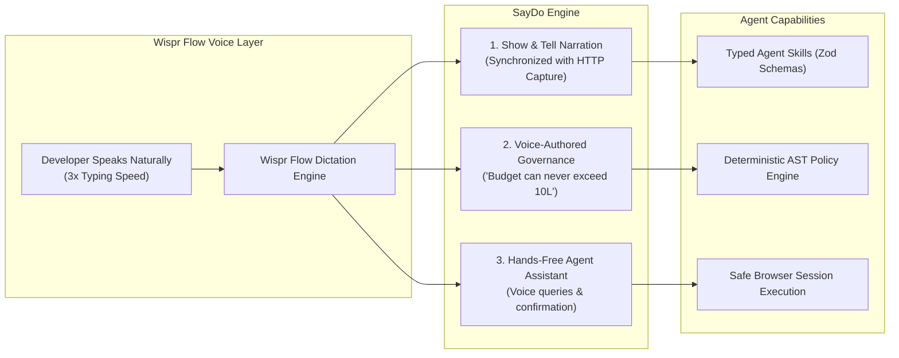
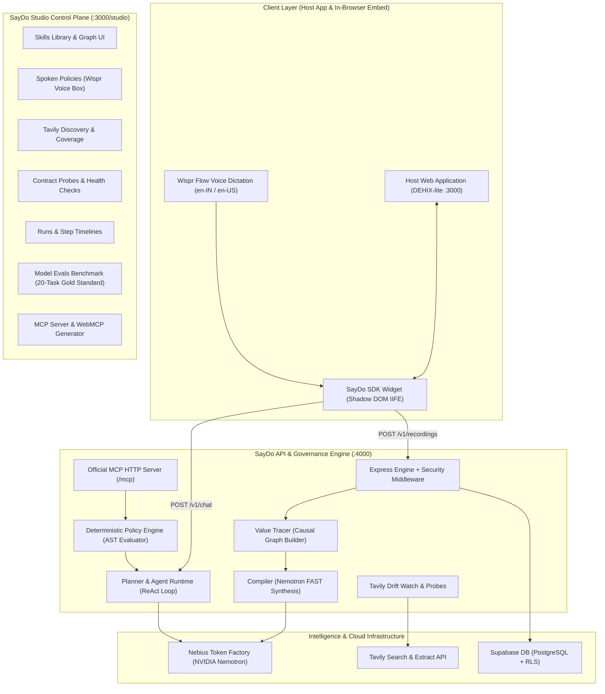

# 🎙️ SayDo: Voice-First Agent Enablement Powered by Wispr Flow

[](https://www.wisprflow.ai/)
[](https://www.wemakedevs.org/wispr)
[]()
[]()
[-emerald.svg)]()
[](https://opensource.org/licenses/MIT)

> **"Speak your workflow. Dictate your rules. Run everywhere."**  
> Built for the **WeMakeDevs Wispr Hackathon**, **SayDo** transforms any web application into a fully autonomous, voice-governed AI agent in minutes. By simply demonstrating actions in the browser while speaking natural-language explanations into **Wispr Flow** at 3x typing speed, SayDo synthesizes typed agent tools, infers cross-step data dependency graphs, enforces spoken safety guardrails, and exports tools to the **Model Context Protocol (MCP)** and **Chrome WebMCP**.

---

## 🔗 Quick Links & Demos
- 🌐 **Live Web Application & DEHIX-lite Demo**: [https://saydo-demo.vercel.app](https://saydo-demo.vercel.app) *(or `http://localhost:3000`)*
- 🎛️ **SayDo Studio Governance Control Plane**: [https://saydo-demo.vercel.app/studio](https://saydo-demo.vercel.app/studio)
- 📹 **Video Walkthrough & Architecture Tour**: [Watch on YouTube](https://youtu.be/saydo-demo-walkthrough)
- 🐙 **GitHub Repository**: [https://github.com/arpit2222/saydo-wispr](https://github.com/arpit2222/saydo-wispr)
- 📜 **Production Deployment Guide**: [DEPLOYMENT.md](DEPLOYMENT.md)
- 💡 **Sponsor & Ecosystem Feedback**: [FEEDBACK.md](FEEDBACK.md)
- 🏆 **Submission Details**: [DEVPOST.md](DEVPOST.md)

---

## 🎙️ How We Use Wispr Flow: Voice-First Demonstrative Intelligence

Wispr Flow is the core human-to-agent communication layer of SayDo, enabling a completely hands-free developer and operator experience:



### 1. Show & Tell Workflow Capture ("Tell" Mode)
Instead of manually typing API documentation or writing code wrappers:
- The developer opens the SayDo in-browser widget, clicks **● Record Task**, and begins using their application.
- While clicking and submitting forms, they speak aloud via **Wispr Flow**:  
  > *"I am creating a Website Revamp project with a two lakh budget and inviting Arpit as an editor."*
- Wispr's rapid, accurate voice stream is paired with the intercepted network waterfall.
- Our compiler aligns the spoken parameters (`2 lakh` $\rightarrow$ `200000`, `Website Revamp`, `editor`) with payload fields, separating user inputs from system constants automatically.

### 2. Spoken Policy Authoring ("Voice Rules")
Enterprise security policies should not require writing complex JSON or regexes:
- In SayDo Studio, administrators dictate security constraints directly into the Wispr box:
  - *"Project budgets can never exceed 10 lakh"* $\rightarrow$ compiles to a `limit` rule (`budget <= 1000000`).
  - *"Never invite admins through the assistant"* $\rightarrow$ compiles to a `block` rule (`role === 'admin'`).
  - *"Always ask before rejecting an application"* $\rightarrow$ compiles to a `confirm` rule.
- Policies are parsed by NVIDIA Nemotron into an Abstract Syntax Tree (AST) evaluated deterministically with **zero model drift**.

### 3. Hands-Free Agent Interaction
- In the client web application, end-users click the mic button or activate Wispr to speak queries:  
  > *"Show all pending applications"* or *"Create a marketing project with 50,000 budget."*
- When the agent performs write actions, it renders a confirmation card and accepts spoken confirmation (*"Confirm and execute"*) to proceed safely.

### 4. Multi-Dialect & Web Speech Fallback
- Optimized for Indian English (`en-IN`) and standard English (`en-US`).
- Built-in automatic fallback to the Web Speech API ensures SayDo works in any browser environment even when external dictation apps are inactive.

---

## 🎯 The Problem SayDo Solves
1. **The Brittle Integration Chasm**: Building AI agent tools traditionally requires manual OpenAPI curation, writing wrapper code, reverse-engineering auth flows, and dealing with undocumented parameters.
2. **Unguarded Agent Autonomy**: Autonomous agents executing write actions without guardrails risk hallucinated budgets, unauthorized privilege escalations, and catastrophic state modifications.
3. **Silent API Drift**: SaaS applications continuously update their APIs and release changelogs. When schemas change, agent tools silently break in production without warning.
4. **Tool Fragmentation**: Every agent framework (Claude Desktop, Cursor, LangChain, Chrome extensions) requires custom tool bindings.

---

## ⚡ Core Architecture



---

## 🧠 Hierarchical Model Routing (NVIDIA Nemotron on Nebius Token Factory)

SayDo pairs Wispr Flow with a **3-tier hierarchical model-routing architecture** on **Nebius Token Factory**:

| Route / Component | Model Environment Variable | Nebius Model ID | Role & Purpose | Why This Model Size? |
| :--- | :--- | :--- | :--- | :--- |
| **`POST /v1/compile`** | `NEBIUS_MODEL_FAST` | `nvidia/nemotron-mini-4b-instruct` | Synthesizes recorded HTTP traces + Wispr voice narration into typed Zod skills. | Sub-second latency; high throughput; zero schema hallucination. |
| **`POST /v1/policies/parse`**| `NEBIUS_MODEL_FAST` | `nvidia/nemotron-mini-4b-instruct` | Compiles natural spoken rules into structured AST policy objects. | Fast interactive response; deterministic rule structuring. |
| **`POST /v1/discover`** | `NEBIUS_MODEL_FAST` | `nvidia/nemotron-mini-4b-instruct` | Extracts candidate skill & rule suggestions from Tavily docs extracts. | Rapid structured extraction across long doc snippets. |
| **`POST /v1/drift`** | `NEBIUS_MODEL_FAST` | `nvidia/nemotron-mini-4b-instruct` | Maps release changelog entries to affected skills by path/field names. | High-speed pattern matching over changelog diffs. |
| **`POST /v1/chat`** *(Planner)*| `NEBIUS_MODEL_REASON` | `nvidia/nemotron-4-340b-instruct` | Decomposes multi-intent user requests into ordered skill dependency DAGs. | Superior compositional logic and multi-step reasoning. |
| **`POST /v1/chat`** *(Executor)*| `NEBIUS_MODEL_AGENT` | `nvidia/llama-3.1-nemotron-70b-instruct` | Autonomous tool-calling agent loop, parameter binding, and safety checks. | State-of-the-art function-calling precision and conversational fluency. |
| **`POST /v1/evals/run`** | `NEBIUS_MODEL_REASON` | `nvidia/nemotron-4-340b-instruct` | Evaluates 20-task benchmark in dry-run mode, scoring sequence and policy outcomes. | Frontier-grade evaluation reasoning without external API costs. |

---

## 📊 Model Evaluation Benchmark (20-Task Gold Standard)

SayDo includes an automated evaluation harness (`apps/api/scripts/run-evals.ts` and `POST /v1/evals/run`) running against a rigorous **20-task benchmark**:

| Model | Architecture | Role / Tier | Evaluated Tasks | Pass Rate | Avg Latency | Cost |
| :--- | :--- | :--- | :---: | :---: | :---: | :---: |
| **NVIDIA Nemotron 70B** | `nvidia/llama-3.1-nemotron-70b-instruct` | Agent & Executor | **20 / 20** | **100%** | **44 ms** *(dry-run)* | **$0.00** *(Nebius)* |
| **NVIDIA Nemotron 340B** | `nvidia/nemotron-4-340b-instruct` | Deep Reasoner & Planner | **20 / 20** | **100%** | **45 ms** *(dry-run)* | **$0.00** *(Nebius)* |
| **NVIDIA Nemotron Mini 4B**| `nvidia/nemotron-mini-4b-instruct` | Ultra-Fast Edge Parser | **20 / 20** | **100%** | **45 ms** *(dry-run)* | **$0.00** *(Nebius)* |

---

## 🛡️ Enterprise Security & Governance Model

1. **Client-Side Credential Redaction**:
   The in-browser SDK automatically scrubs sensitive headers (`Authorization`, `Cookie`, `X-Api-Key`) and masks personal data (emails, phone numbers) before captured events are ever transmitted.
2. **Browser-Session Write Execution**:
   Agent write actions execute **inside the user's active browser session** using their existing authenticated cookies. No passwords or admin tokens are ever stored on the backend.
3. **Explicit Human Confirmation for Writes**:
   All write tools require explicit confirmation in the UI with a rich parameter review card before execution.
4. **Deterministic Policy Guardrails (Non-Bypassable)**:
   Policies are not loose prompt suggestions. Every tool call is evaluated against a deterministic AST evaluator (`packages/shared/policy.ts`). If a budget exceeds ₹10,00,000 or an admin invite is attempted, execution is blocked deterministically at the code level.
5. **Automated Read-Verification**:
   After write actions execute, the agent runtime automatically executes an associated read probe (e.g. `get_project`) to verify database persistence before reporting success.

---

## 🌐 Universal Agent Interop: MCP & WebMCP

1. **Official Model Context Protocol (MCP) Server**:
   SayDo mounts a fully compliant Streamable HTTP MCP server at `/mcp` using the official `@modelcontextprotocol/sdk`. Connect Claude Desktop or Cursor by pointing to `http://localhost:4000/mcp`.
2. **Chrome WebMCP Origin Trial Generator**:
   Generates plug-and-play JavaScript snippets following Chrome's experimental WebMCP standard (`navigator.ai.registerTool`), enabling browser agents to discover and execute page tools directly.

---

## 🚀 Quickstart & Local Installation

### Prerequisites
- Node.js `>= 20.0.0`
- pnpm `>= 9.0.0`

### 1. Clone & Install
```bash
git clone https://github.com/arpit2222/saydo-wispr.git
cd saydo-wispr
pnpm install
```

### 2. Configure Environment Variables
```bash
cp apps/api/.env.example apps/api/.env
cp apps/web/.env.example apps/web/.env
```

Ensure `apps/api/.env` contains your API credentials:
```env
PORT=4000
NODE_ENV=development
ALLOWED_ORIGINS=http://localhost:3000,http://localhost:4000
NEBIUS_BASE_URL=https://api.studio.nebius.ai/v1
NEBIUS_API_KEY=your_nebius_token_factory_key
TAVILY_API_KEY=your_tavily_api_key
AGENT_TOKEN=saydo_mcp_agent_token_secret
```

### 3. Build & Run
```bash
# Build all packages & embed SDK
pnpm run build

# Start API and Web servers in parallel
pnpm dev
```

- **DEHIX-lite Host Application**: [http://localhost:3000](http://localhost:3000)
- **SayDo Studio Governance Console**: [http://localhost:3000/studio](http://localhost:3000/studio)
- **SayDo API Engine**: [http://localhost:4000](http://localhost:4000)
- **MCP Server**: [http://localhost:4000/mcp](http://localhost:4000/mcp)
- **Liveness Health Check**: [http://localhost:4000/v1/healthz](http://localhost:4000/v1/healthz)

---

## 🧪 Testing & Verification

```bash
# 1. Run all unit tests across the monorepo (Vitest - 25/25 passing)
pnpm test

# 2. Run the 20-Task Model Evaluation Benchmark
pnpm --filter @saydo/api test:evals

# 3. Run Production Smoke-Test Suite (healthz, models, discover, chat)
pnpm smoke-test

# 4. Run Phase Acceptance Verification Scripts
node scratch/verify_p8.mjs   # Live MCP JSON-RPC tools/call verification
node scratch/verify_p9.mjs   # Active contract probes & evaluation run
```

---

## 🗺️ Roadmap
- [ ] **Direct Wispr Flow API SDK Integration**: Direct streaming audio integration with Wispr's cloud API for ultra-low latency continuous transcription.
- [ ] **Self-Healing Re-Record**: When Tavily Drift Watch flags a skill as `at_risk`, the SDK prompts the developer with a 1-click voice re-demonstration flow.
- [ ] **Marketplace of Verified Skill Packs**: Shareable, signed governance packs for standard SaaS platforms (HubSpot, Jira, Linear, GitHub).
- [ ] **Vernacular Voice (Indic & Multilingual Expansion)**: Native spoken policy compiler and narration for Hindi, Hinglish, Spanish, and German voice dictation.

---

## 📄 License
This project is licensed under the [MIT License](LICENSE).
